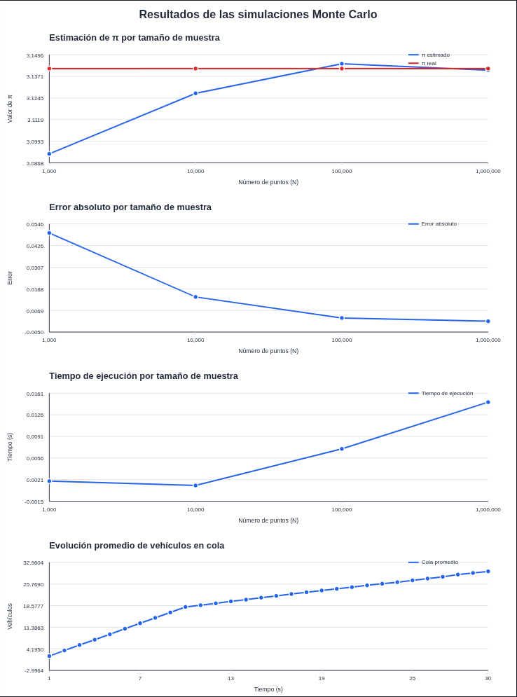
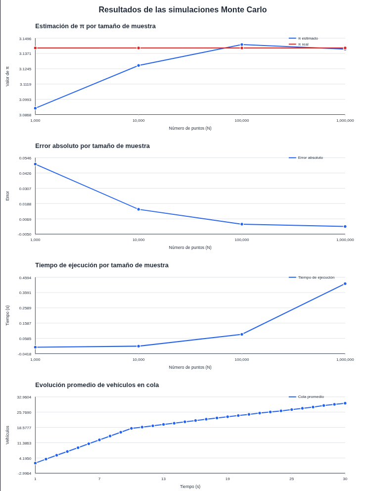

# Simulación de resultados mediante el método de Monte Carlo (Práctica 7)

## 1. Descripción del proyecto

- **Objetivo:** Aplicar el método de Monte Carlo para obtener aproximaciones numéricas mediante experimentos aleatorios.
- **Propósito:** Analizar cómo influye el tamaño de la muestra en la estimación de π y comparar los tiempos de ejecución de las implementaciones en Python y Java.
- **Problema resuelto:** El proyecto automatiza la estimación de π y simula la evolución de una cola vehicular durante los ciclos de un semáforo. Los resultados se muestran en la consola y en una gráfica SVG.

### Modelos utilizados

#### Estimación de π por Monte Carlo

Se generan puntos aleatorios en un cuadrado que contiene un círculo inscrito. Si $N_c$ puntos caen dentro del círculo y $N$ es el total de puntos, la aproximación es:

$$
\pi \approx 4\frac{N_c}{N}
$$

Se utilizan muestras de 1 000, 10 000, 100 000 y 1 000 000 de puntos. Se registra la estimación, su error absoluto y el tiempo de ejecución.

#### Modelo de cola vehicular

La variación de la cantidad de vehículos en cola se representa mediante:

$$
\frac{dQ(t)}{dt} = \lambda(t) - \mu(t)
$$

Donde \(Q(t)\) es la cantidad de vehículos en cola, \(\lambda(t)\) es la tasa de llegada y \(\mu(t)\) es la tasa de salida. El ciclo del semáforo cumple \(T=R+G\), donde \(R\) es la duración de la luz roja y \(G\) la de la luz verde.

## 2. Tecnologías utilizadas

- **Lenguajes:** Python 3.x y Java.
- **Python:** No requiere dependencias externas; `Python/requirements.txt` se conserva para registrar los requerimientos del proyecto.
- **Java:** Requiere un JDK que incluya `javac` y `java`.
- **Gráficas:** SVG generado por el propio proyecto, sin dependencias externas.

## 3. Instalación

### 3.1. Obtener el proyecto

Clona el repositorio y cambia al directorio de esta práctica:

```bash
git clone https://github.com/Dan-San837/Simulacion.git
cd Simulacion/Practica7
```

### 3.2. Preparar Python

La creación de un entorno virtual es opcional, pero recomendada:

```bash
cd Python
python3 -m venv .venv
```

Activación del entorno:

```bash
# Linux o macOS
source .venv/bin/activate

# Windows PowerShell
.venv\Scripts\Activate.ps1
```

Instala los requerimientos declarados:

```bash
python -m pip install -r requirements.txt
```

Actualmente no se requieren paquetes externos.

### 3.3. Preparar Java

Instala un JDK y comprueba que `java` y `javac` estén disponibles en el `PATH`. No se requieren bibliotecas externas.

## 4. Uso

### 4.1. Ejecutar la implementación en Python

Desde el directorio raíz de la práctica:

```bash
cd Python
python3 main.py
```

En Windows también se puede ejecutar con `python main.py`.

### 4.2. Ejecutar la implementación en Java

Desde el directorio raíz de la práctica:

```bash
cd Java
mkdir -p bin
javac -d bin $(find src -name "*.java")
java -cp bin Main
```

El comando de compilación con `find` está pensado para Linux y macOS. En Windows, compila los archivos `.java` de `src` con `javac` y guarda las clases en `bin` antes de ejecutar `java -cp bin Main`.

### 4.3. Resultados

Cada implementación imprime en la consola los resultados del experimento de π y el resumen de la simulación de tráfico. También genera `resultados_monte_carlo.svg` en su propio directorio (`Python/` o `Java/`). Abre ese archivo con un navegador para consultar las gráficas.

## 5. Estructura del proyecto

| Carpeta/Archivo | Descripción |
|-----------------|-------------|
| `.gitignore` | Excluye entornos virtuales, bytecode, clases compiladas y gráficas generadas. |
| `Python/main.py` | Punto de entrada de la implementación Python; ejecuta los experimentos e imprime y grafica los resultados. |
| `Python/controller/simulation_controller.py` | Coordina los experimentos y comunica los modelos con las vistas. |
| `Python/model/monte_carlo.py` | Contiene el modelo para estimar π mediante Monte Carlo. |
| `Python/model/traffic_model.py` | Contiene el modelo de simulación de la cola vehicular. |
| `Python/view/console_view.py` | Presenta los resultados en la consola. |
| `Python/view/svg_chart_view.py` | Genera las gráficas SVG. |
| `Python/requirements.txt` | Archivo de requerimientos de Python; actualmente no declara dependencias externas. |
| `Java/src/Main.java` | Punto de entrada de la implementación Java. |
| `Java/src/controller/SimulationController.java` | Coordina la ejecución de los experimentos. |
| `Java/src/model/` | Contiene los modelos de estimación de π y de cola vehicular, además de sus resultados. |
| `Java/src/view/` | Contiene las vistas de consola y de generación de gráficas SVG. |
| `README.md` | Documentación original del proyecto. |

Las clases compiladas de Java se crean en `Java/bin/`, que no se incluye en el repositorio. El entorno virtual y los archivos `__pycache__` de Python tampoco se comparten: se recrean localmente cuando se necesiten.

## 6. Información adicional

- **Arquitectura:** Ambas implementaciones separan modelos, controlador y vistas (MVC).
- **Parámetros usados:** La ejecución principal utiliza tasas de llegada y salida de 0.8 y 1.2 vehículos por segundo, respectivamente; duraciones de 10 segundos para rojo y 20 para verde; intervalo de 1 segundo y 250 simulaciones de tráfico.
- **Resultados generados:** Las gráficas comparan las estimaciones y errores de π, los tiempos de ejecución y la evolución promedio de la cola vehicular.
- **Archivos generados:** Las gráficas SVG no se versionan; cada persona puede regenerarlas ejecutando el programa correspondiente.

- **Capturas:**

    Java:
  
    
    
    Python:
  
    


### 6.1. Declaraciòn de uso de IA
**Herramienta utilizada:** OpenCode

**Forma de Uso:** La herramienta fue utilizada como apoyo para revisar, corregir e identificar errores en la estructura del còdigo desarrollado.

**Alcance de su intervenciòn:** Medio


### Flujo del proyecto

1. **Definición:** Se plantea estimar π mediante puntos aleatorios y modelar la evolución de una cola vehicular.
2. **Tecnologías:** Se utilizan Python y Java, con gráficas SVG generadas sin bibliotecas externas.
3. **Instalación:** Se obtiene el repositorio, se prepara Python opcionalmente con un entorno virtual y se comprueba la instalación del JDK para Java.
4. **Uso:** Se ejecuta `Python/main.py` o se compila y ejecuta la clase `Main` de Java.
5. **Estructura:** Se identifican los modelos, controladores y vistas MVC de cada implementación, así como los archivos de configuración y documentación.
